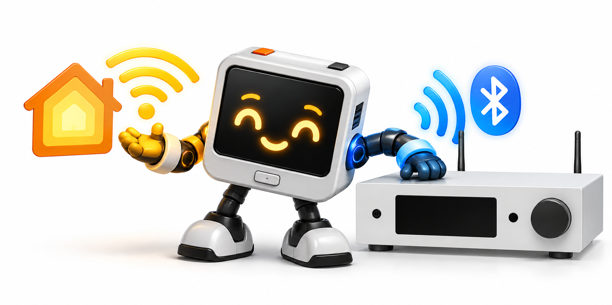
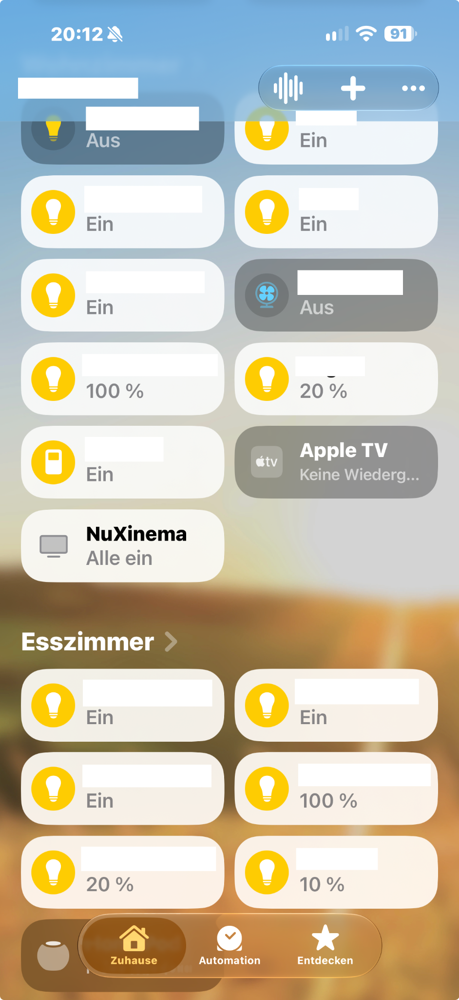
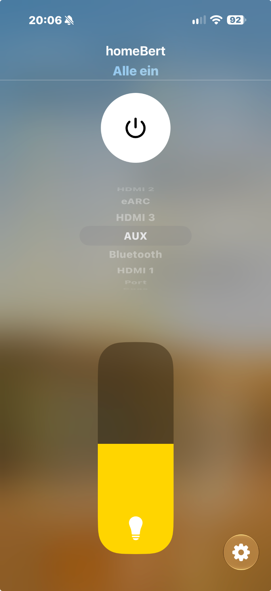

# homeBert

**Lokale Apple-Home-Bridge für den Nubert nuXinema preAV – ohne Cloud, Homebridge, Home Assistant oder zusätzlichen Server.**

homeBert läuft auf einem M5Stack ATOM Lite und verbindet einen nuXinema preAV über Bluetooth Low Energy (BLE) mit Apple Home. Der Receiver bleibt die maßgebliche Quelle für seinen Zustand: homeBert veröffentlicht Power, Eingang und Lautstärke erst anhand bestätigter BLE-Rückmeldungen.

> **Status: 0.4.0 – erste öffentliche HomeKit-Edition (Release-Vorbereitung).** homeBert ist ein unabhängiges persönliches Community-Projekt. Es funktioniert in der Entwicklungsumgebung, garantiert jedoch weder Stabilität, Verfügbarkeit noch Kompatibilität mit anderer Hardware oder Konfiguration. Die Freigabe von Binärdateien setzt die noch offene Lizenzprüfung voraus.

<p align="center"></p>

## Was homeBert kann

- Native Apple-Home-/HomeKit-Anbindung als Fernsehzubehör.
- Ein- und Standby-Schalten, Lautstärke und Eingangswahl.
- Automatische Surround-Wahl nach einer **von Apple Home ausgelösten und vom Receiver bestätigten** Eingangswahl: Auto für eARC/HDMI, Stereo für die übrigen Eingänge.
- Bidirektionale Zustandsübernahme: Änderungen über Fernbedienung oder Gerät werden über BLE-Rückmeldungen in Apple Home sichtbar.
- Lokale WLAN- und BLE-Einrichtung über einen temporären Setup-Hotspot; HomeKit-Pairing per gerätespezifischem Code oder QR-Code.
- Serielle Diagnose und zwei OTA-fähige Anwendungs-Partitionen.

Surround wird intern überwacht, ist jedoch kein separates HomeKit-Steuerelement. Ändernde Receiver-Befehle sind ausschließlich bei bestätigt eingeschaltetem Receiver erlaubt; homeBert weckt ihn nicht durch eine Lautstärke- oder Eingangsanfrage.

## Unterstützte Hardware und Kompatibilität

| Bereich | Stand |
|---|---|
| Bridge | **M5Stack ATOM Lite**, ESP32-PICO-D4, 4 MB Flash, kein PSRAM |
| Receiver | **Nubert nuXinema preAV** – einzig praktisch getestetes Modell |
| Netzwerk | 2,4-GHz-WLAN und BLE-Reichweite zum Receiver |
| Apple Home | Native HomeKit-Kopplung, iPhone/iPad für Einrichtung |

Andere Nubert-Geräte können das in der Einrichtung verwendete Werbe-Service-UUID ausstrahlen. Das beweist weder das gleiche GATT-Protokoll noch eine Kompatibilität; sie werden daher nicht als unterstützt beworben.

Es gibt derzeit **eine** buildbare Firmwarekonfiguration. Eine separate
„Advanced“-Edition ist noch nicht verfügbar. Eine Home-Assistant-Integration
ist ebenfalls nicht Teil von 0.4.0 und wird gegebenenfalls getrennt betrachtet.

## Apple Home

<p align="center"> </p>

Power ON und Standby, Lautstärke sowie die BLE-Zustandssynchronisierung wurden am nuXinema preAV erprobt. AUX wurde als Eingang einzeln geprüft; die übrigen Eingangswerte folgen beobachteten Statuszuordnungen und verwenden dasselbe Befehlsformat. Details, Sicherheitsregeln und der Validierungsstand stehen in [HomeKit und BLE-Protokoll](docs/phase-2-homekit.md).

## Schnellstart

1. Die Firmware auf einen ATOM Lite flashen.
2. Das temporäre WLAN **homeBert Setup** öffnen und `http://192.168.4.1/` aufrufen.
3. Einen erkannten Nubert-Receiver auswählen. Die offizielle Nubert-App vorher vollständig schließen, damit sie keine BLE-Steuerverbindung hält.
4. Ein 2,4-GHz-WLAN auswählen oder manuell eingeben und speichern.
5. Nach dem Wechsel ins Heim-WLAN homeBert in Apple Home hinzufügen. Der Abschlussbildschirm und die serielle Konsole zeigen den aktuellen gerätespezifischen Setup-Code und QR-Code.

Die vollständige Anleitung einschließlich Wiederherstellung steht unter [Einrichtung und Wiederherstellung](docs/setup-flow.md).

## Firmware installieren und aktualisieren

`./tools/release.sh` erzeugt lokal zwei Images unter `build/release/`:

| Datei | Zweck | Flash-Adresse |
|---|---|---:|
| `homebert-full.bin` | Erstinstallation mit Bootloader, Partitionstabelle und App | `0x0` |
| `homebert-update.bin` | Nur Anwendung in `app0`; erhält NVS-Daten | `0x10000` |

```bash
# Erstinstallation – löscht den von diesem Image beschriebenen NVS-Bereich
esptool --chip esp32 --port <PORT> --baud 115200 write-flash -z 0x0 homebert-full.bin

# Bestehende app0-Installation aktualisieren – erhält WLAN, BLE-Auswahl und HomeKit-Daten
esptool --chip esp32 --port <PORT> --baud 115200 write-flash -z 0x10000 homebert-update.bin
```

Das Update-Image setzt die gegenwärtige `app0`-Partition voraus. Die Firmware besitzt zwei OTA-fähige App-Partitionen; ein separater, für Endnutzer dokumentierter Netzwerk-OTA-Ablauf gehört jedoch nicht zu diesem Release. Release-Erzeugung, Prüfsummen, Größenprüfung und Versionsprovenienz sind unter [Versionierung und lokale Releases](docs/versioning.md) beschrieben.

## Taster und LED

<p align="center"></p>

Die Grafik zeigt Lage und Funktion der Bedienelemente. Für Farben, Blinkmuster
und Zeitwerte ist die **aktuelle** Textreferenz maßgeblich:

- Start: kurz weiß; beim anfänglichen BLE-Aufbau mindestens etwa zwei Sekunden blau blinkend.
- Voll verbunden: fünf Sekunden grün, danach im stabilen Betrieb aus.
- Kurz Fronttaster drücken: Zustand fünf Sekunden anzeigen.
- Doppelt drücken: BLE-Verbindung neu aufbauen.
- Fronttaster zehn Sekunden halten: Werksreset. Der kleine seitliche Reset-Taster startet nur den ESP32 neu und löscht keine Konfiguration.
- Setup: gelb blinkend; Warnzustände sind in der Detailreferenz beschrieben.

Die vollständigen Prioritäten, Zeiten und Hinweise zum Werksreset stehen in [LED und Taster](docs/LED_AND_BUTTON.md). Der gelb blinkende Setup-Zustand ist auf Hardware beobachtet; die WLAN-Fehlerbilder sind bislang automatisiert, nicht abschließend physisch validiert.

## Grenzen und Hinweise

- Die Nubert-App und homeBert können praktisch um eine BLE-Steuerverbindung konkurrieren. Die App vor Einrichtung oder Fehlersuche vollständig schließen.
- Apple Home kann Eingangsbezeichnungen und Darstellung zwischenspeichern; homeBert kann Apples Benutzeroberfläche nicht erzwingen.
- BLE-Verbindungswiederherstellung nach einem Receiver-Stromausfall benötigt weiterhin Hardwarevalidierung der vorhandenen Diagnose-/Testpfade.
- homeBert ist ein unabhängiges Community-Projekt. Nubert, nuXinema, Apple und HomeKit sind Marken ihrer jeweiligen Inhaber; daraus folgt keine Unterstützung oder Freigabe durch diese Unternehmen.

## Dokumentation

| Thema | Maßgebliche Quelle |
|---|---|
| Einrichtung, Pairing und Wiederherstellung | [docs/setup-flow.md](docs/setup-flow.md) |
| LED, Fronttaster und Hardware-Reset | [docs/LED_AND_BUTTON.md](docs/LED_AND_BUTTON.md) |
| Serielle Konsole und BLE-Diagnose | [docs/SERIAL_CONSOLE.md](docs/SERIAL_CONSOLE.md) |
| HomeKit-Modell, BLE-Protokoll und Sicherheitsregeln | [docs/phase-2-homekit.md](docs/phase-2-homekit.md) |
| Architektur | [docs/architecture.md](docs/architecture.md) |
| Versionierung und lokale Release-Erzeugung | [docs/versioning.md](docs/versioning.md) |
| Entwurf der Release Notes 0.4.0 | [docs/release-notes-0.4.0.md](docs/release-notes-0.4.0.md) |
| Release-Readiness | [docs/release-readiness.md](docs/release-readiness.md) |
| Privacy- und Lizenzprüfung | [docs/publication-review.md](docs/publication-review.md) |
| Lizenzrecherche für Binärweitergabe | [docs/licensing-and-redistribution.md](docs/licensing-and-redistribution.md) |
| Drittanbieterhinweise | [THIRD_PARTY_NOTICES.md](THIRD_PARTY_NOTICES.md) |

## Lizenz

Der eigene homeBert-Quellcode steht unter der [MIT-Lizenz](LICENSE). Abhängigkeiten und Firmware-Binäranteile haben eigene Lizenzen. Vor einer öffentlichen Binärverteilung müssen die offenen Punkte der [Lizenzrecherche](docs/licensing-and-redistribution.md) erledigt sein.

Die redigierte Privacy- und Lizenzprüfung mit dem Unterschied zwischen
Quellcode- und Binärverteilung steht unter
[Publication Review](docs/publication-review.md).
